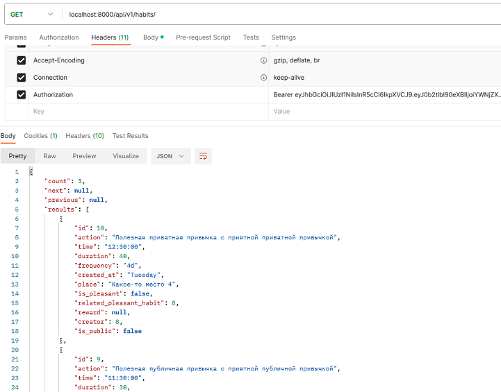

# Backend for SPA Web Application


## Overview

REST API built with **Django Rest Framework** for an application focused on **atomic habit tracking**.

The system provides:

- User registration and authentication
- Full CRUD functionality for the **Habit** model
- Access control using **JWT authentication**
- Data validation at the **serializer level**

The application also includes **integration with the Telegram API** to send notifications to users.

The project includes **unit test coverage** and **API documentation**.

---

## Example GET Response



---

## Project Structure

* habits
  - accounts - User management
  - habits - Project configuration
  - habits_app - Habit management logic
  - utils - External service integrations
    - TG.py - Telegram API integration
  - manage.py

* readme_assets - Assets used in README.md
* .env.sample - Example environment configuration
* README.md


## Project Setup

The project requires **PostgreSQL** and **Redis**.

Clone the repository:

```bash
git clone https://github.com/Lio-Kay/DRF_Habits_Tracker
  ```

Create a .env file based on .env.sample and configure the environment variables.

Create a PostgreSQL database and start the Redis server.

Run the application:
  ```sh
  poetry update
  cd .\habits\
  python manage.py runserver
  ```
Running telegram notification workers:
  ```sh
  unix:
  celery -A habits worker -l INFO
  windos:
  celery -A habits1 worker -l INFO -S eventlet
  ---
  celery -A habits beat -l INFO -S eventlet
  ```

## Technologies
* Django+DRF;
  - drf-yasg;
  - djangorestframework-simlejwt;
  - django-cors-headers;
* redis;
* celery;
* psycopg2-binary;
* python-dotenv;
* requests.

## Additional Features
* Custom implementation of BaseUserManager and AbstractUser for extended user registration
* 90%+ unit test coverage
* API endpoint documentation generated using OpenAPI
